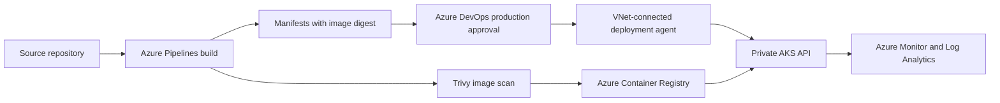

# AKS Operations Platform

An Azure DevOps portfolio project with a private Azure Kubernetes Service cluster, a Flask operations dashboard, and an approval-gated rollout. Terraform provisions the Azure foundation. Azure Pipelines builds the container, blocks high and critical Trivy findings, and deploys the scanned image by digest.



## Run locally

```sh
docker build -t aks-operations:local application
docker run --rm --read-only --tmpfs /tmp -p 127.0.0.1:5000:5000 aks-operations:local
```

Visit [localhost:5000/health](http://localhost:5000/health). The health, version, and information routes work without cluster access. The dashboard is opt-in, runs without a mounted Kubernetes token by default, and uses read-only namespaced permissions when enabled. Enable it only on an authenticated or private route.

## Deploy to Azure

1. Create the `AKS-Operations-Agents` pool, an Azure Storage backend, and a bootstrap Key Vault. Store a short-lived Azure DevOps agent-registration PAT as `ado-agent-pat`. The Terraform configuration uses the existing `prod-bootstrap-rg/prod-bootstrap-kv` vault and grants the agent's managed identity permission to read it.
2. In `terraform/environments/prod`, copy the two example files to `terraform.tfvars` and `backend.hcl`. Fill in your Azure IDs, registry and vault names, Entra administrator group, DevOps organization, and agent SSH public key. Review costs for AKS, its nodes, the agent VM, Azure Container Registry, and Log Analytics before applying. The system nodes default to `Standard_D4s_v5` and the separate agent VM defaults to `Standard_B2s`. Check regional SKU availability and quota before applying. [AKS system node requirements](https://learn.microsoft.com/en-us/azure/aks/use-system-pools)
3. Run `terraform init -backend-config=backend.hcl` and review `terraform plan -out=aks.tfplan`. Apply the reviewed plan. Use an identity with access to create the resources and role assignments and to write state blobs using Microsoft Entra authentication.
4. From a host that can reach the private AKS API, create the `aks-operations` namespace and grant the pipeline identities access as described in the [release runbook](docs/operations.md).
5. Configure `azure-devops/CI.yaml` in Azure DevOps Services. Configure the `AKS-Operations-Variables` group with `ACR_LOGIN_SERVER`, and authorize the ACR and AKS service connections. Set the approval check on the `production` environment. [Azure Pipelines approvals](https://learn.microsoft.com/en-us/azure/devops/pipelines/process/approvals?view=azure-devops)

The default workload is a ClusterIP service. The [optional HTTPS Gateway](application/networking/gateway.example.yaml) requires the AKS-managed Gateway API implementation, deployment-specific DNS, and a Kubernetes TLS Secret. It is deliberately outside the pipeline manifests. Keep the dashboard disabled on a public gateway. [AKS Gateway API setup](https://learn.microsoft.com/en-us/azure/aks/app-routing-gateway-api)

## Verification

GitHub Actions runs the Terraform format and schema checks, dashboard regression tests, and a container build without cloud credentials. Azure Pipelines handles delivery inside the private network. The [operations runbook](docs/operations.md) covers namespace access, rollout verification, rollback, and cleanup.

## Attribution

Adapted from Debabrata Pain's Enterprise-Grade AKS Platform. The original [MIT license](LICENSE) and copyright notice are retained.
