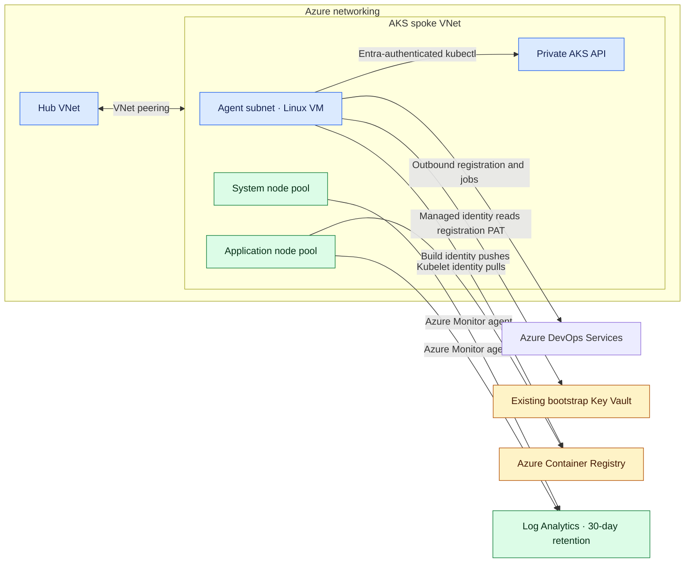
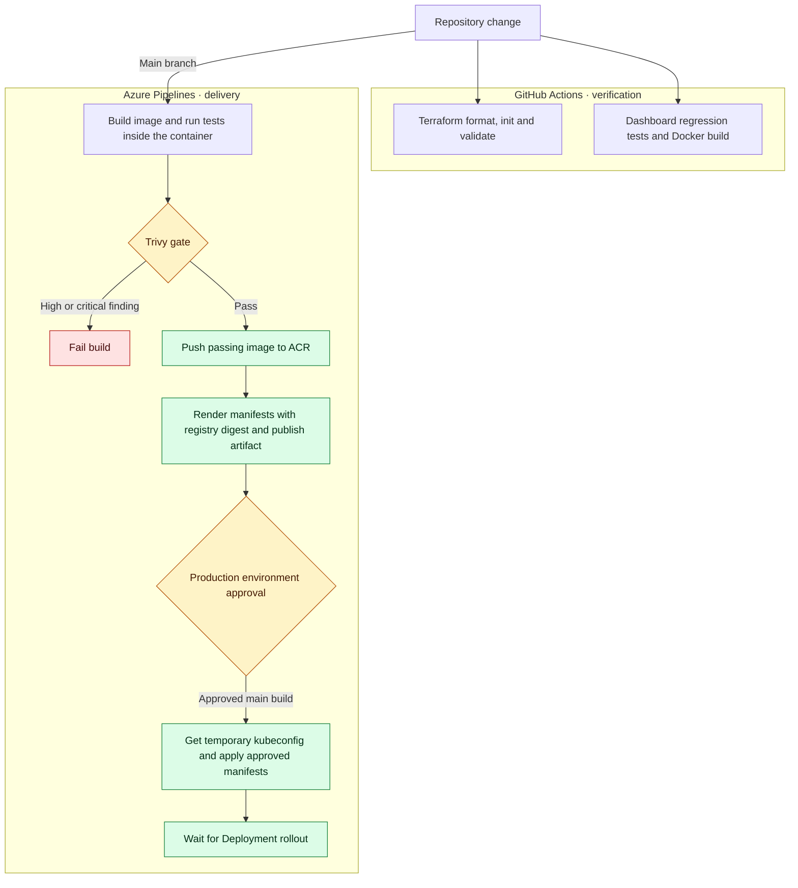
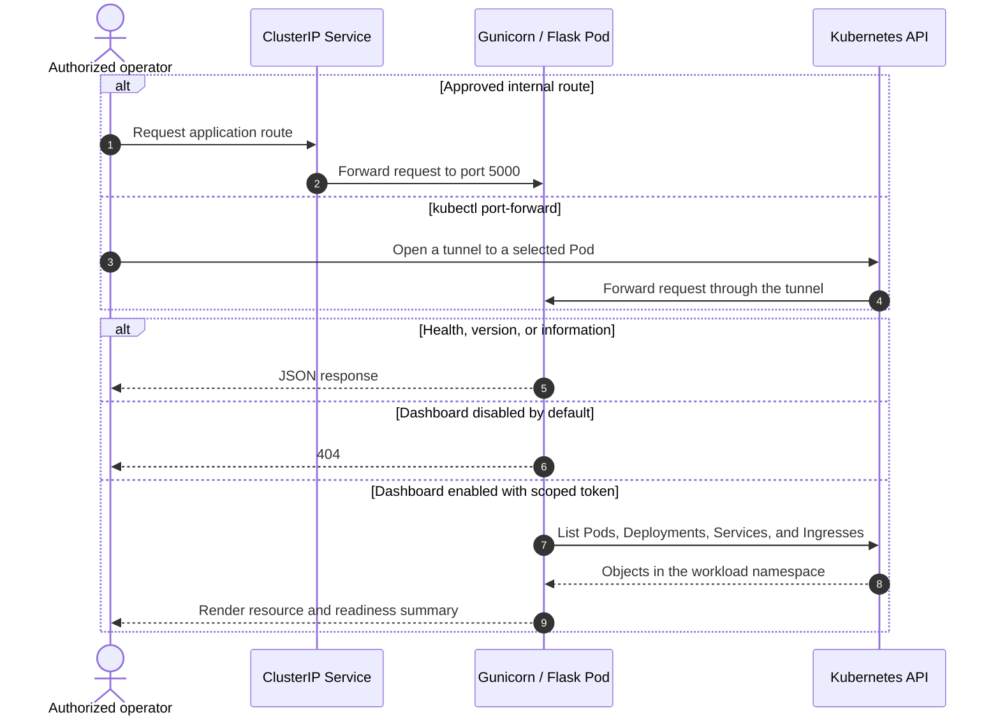
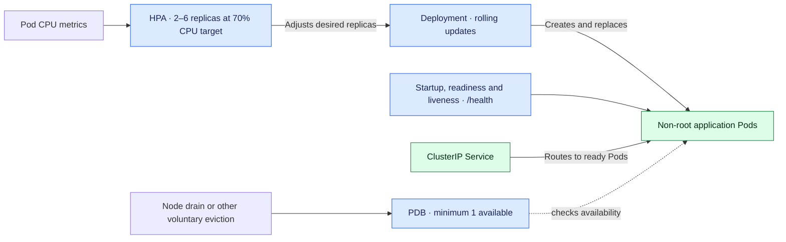
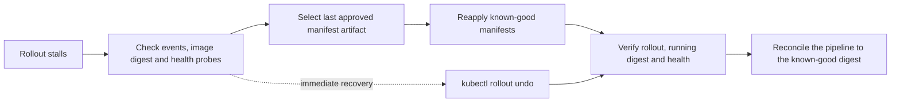

# AKS Operations Platform

**A private AKS environment with a delivery pipeline that scans an image before publishing it and deploys that exact digest after approval.**

[](https://github.com/Pradyut6/aks-operations-platform/actions/workflows/validate.yml)

[Architecture](#azure-architecture) · [Release workflow](#from-commit-to-approved-rollout) · [Workload traffic](#application-and-dashboard-traffic) · [Availability](#scaling-and-rollout-controls) · [Local run](#run-locally) · [Azure deployment](#deploy-to-azure)

## Azure architecture

Terraform defines a hub and AKS spoke with VNet peering. A self-hosted Azure DevOps agent sits in the AKS VNet, where it can reach the private Kubernetes API. The registry, bootstrap vault, and monitoring workspace serve different parts of the platform.



| Boundary | Identity and access |
| --- | --- |
| Agent registration | The VM's managed identity reads the registration PAT from the existing bootstrap vault. |
| Registry publication | A dedicated Azure DevOps service connection uses registry-scoped push permission. |
| Kubernetes release | A separate deployment connection gets cluster credentials and applies resources within the `aks-operations` namespace. |
| Image pulls | The AKS kubelet identity has `AcrPull` on the registry. |
| Dashboard reads | When enabled, a Kubernetes service account can get or list four resource types within the workload namespace. |

[Production Terraform](terraform/environments/prod) · [Role assignments](terraform/environments/prod/rbac.tf) · [Access setup](docs/operations.md#bootstrap-access)

## From commit to approved rollout

GitHub Actions validates the repository with two credential-free jobs. The Azure Pipelines definition handles delivery on the self-hosted agent. The production approval is configured on the Azure DevOps environment.



The build artifact contains the Kubernetes manifests and `image-digest.txt`. The deployment step checks that the manifest contains that digest, applies the artifact, and waits up to 180 seconds for rollout. GitHub verification and Azure delivery are separate workflows.

[GitHub verification](.github/workflows/validate.yml) · [Azure Pipeline](azure-devops/CI.yaml) · [Build template](azure-devops/templates/docker-build-image.yml) · [Deploy template](azure-devops/templates/deploy-aks.yml)

## Application and dashboard traffic



| Route | What it shows |
| --- | --- |
| `/` | Application name, status, and version |
| `/health` | Process health and a timestamp |
| `/version` | Application version |
| `/info` | Configured environment |
| `/dashboard` | Namespaced workload inventory and readiness, when enabled |

The dashboard starts disabled and Pods start without an API token. Enabling it requires both the feature flag and the token mount. Its readiness summary describes Kubernetes Deployment status at request time. [Application code](application/app.py) · [Dashboard RBAC](application/k8s/dashboard-rbac.yaml)

## Scaling and rollout controls



The Deployment starts with two replicas and uses `maxUnavailable: 0` and `maxSurge: 1` during rolling updates. The HPA depends on the Kubernetes resource metrics API and the Pod CPU request. The PDB limits voluntary evictions such as node drains. Each Pod uses a read-only root filesystem, a writable `/tmp` mount, and a non-root user.

[Deployment](application/k8s/deployment.yaml) · [HPA](application/k8s/hpa.yaml) · [PDB](application/k8s/pdb.yaml)

## Rollout recovery



Use the [operations runbook](docs/operations.md#diagnose-and-roll-back) to distinguish agent connectivity, registry authorization, and workload readiness failures.

## Run locally

```sh
docker build -t aks-operations:local application
docker run --rm --read-only --tmpfs /tmp -p 127.0.0.1:5000:5000 aks-operations:local
```

Visit [localhost:5000/health](http://localhost:5000/health). The health, version, and information routes work without cluster access. The dashboard is opt-in, runs without a mounted Kubernetes token by default, and uses read-only namespaced permissions when enabled. Enable it only on an authenticated or private route.

## Deploy to Azure

1. Create the `AKS-Operations-Agents` pool, an Azure Storage backend, and a bootstrap Key Vault. Store a short-lived Azure DevOps agent-registration PAT as `ado-agent-pat`. The Terraform configuration uses the existing `prod-bootstrap-rg/prod-bootstrap-kv` vault and grants the agent's managed identity permission to read it.
2. In `terraform/environments/prod`, copy the two example files to `terraform.tfvars` and `backend.hcl`. Fill in your Azure IDs, registry and vault names, Entra administrator group, DevOps organization, and agent SSH public key. Review costs for AKS, its nodes, the agent VM, Azure Container Registry, and Log Analytics before applying. The system nodes default to `Standard_D4s_v5` and the separate agent VM defaults to `Standard_B2s`. Check regional SKU availability and quota before applying. [AKS system node requirements](https://learn.microsoft.com/en-us/azure/aks/use-system-pools)
3. Run `terraform init -backend-config=backend.hcl` and review `terraform plan -out=aks.tfplan`. Apply the reviewed plan. Use an identity with access to create the resources and role assignments and to write state blobs using Microsoft Entra authentication.
4. From a host that can reach the private AKS API, create the `aks-operations` namespace and grant the pipeline identities access as described in the [release runbook](docs/operations.md).
5. Configure `azure-devops/CI.yaml` in Azure DevOps Services. Configure the `AKS-Operations-Variables` group with `ACR_LOGIN_SERVER`, and authorize the ACR and AKS service connections. Set the approval check on the `production` environment. [Azure Pipelines approvals](https://learn.microsoft.com/en-us/azure/devops/pipelines/process/approvals?view=azure-devops)

The default workload is a ClusterIP service. The [optional HTTPS Gateway](application/networking/gateway.example.yaml) requires the AKS-managed Gateway API implementation, deployment-specific DNS, and a Kubernetes TLS Secret. It is deliberately outside the pipeline manifests. Keep the dashboard disabled on a public gateway. [AKS Gateway API setup](https://learn.microsoft.com/en-us/azure/aks/app-routing-gateway-api)

## Verification

GitHub Actions runs the Terraform formatting and configuration validation, dashboard regression tests, and a container build without cloud credentials. Azure Pipelines handles delivery inside the private network. The [operations runbook](docs/operations.md) covers namespace access, rollout verification, rollback, and cleanup.

## Attribution

Adapted from Debabrata Pain's Enterprise-Grade AKS Platform. The original [MIT license](LICENSE) and copyright notice are retained.
